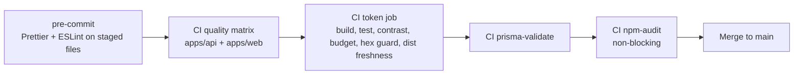

# Quality Gates — What Is Actually Enforced

> **Document:** `QUALITY-GATES.md` | **Version:** 2.0 | **Last Updated:** 2026-11-18
> **Status:** Active | **Owner:** Maintainer | **Review cadence:** Whenever CI changes
>
> This file used to describe an enterprise pipeline (staging gate, Lighthouse CI, PR-size
> checks, quarterly audits) that this repository does not run. It now documents the
> checks that exist. A gate that is not wired is listed as **not implemented**, not as
> policy — an aspirational gate that silently never runs is worse than no gate.

## 1. The pipeline that exists

There is no staging environment and no automated production gate. Deployment and
post-deploy verification are manual; see §6.

## 2. Local gate (pre-commit)

Enforced by husky + lint-staged (`.husky/pre-commit`, `package.json` `lint-staged`):

| Check      | Command            | Scope                 | Blocking   |
| ---------- | ------------------ | --------------------- | ---------- |
| Formatting | `prettier --write` | staged files          | No (fixes) |
| Lint       | `eslint --fix`     | staged `.ts` / `.tsx` | Yes        |

Not wired locally: typecheck, tests, secret scanning, commit-message linting.

## 3. CI gate (GitHub Actions)

Workflow: `.github/workflows/ci.yml`. Runs on pushes to `main`/`develop`, pull requests,
and tags.

### 3.1 `quality` matrix — `apps/api` and `apps/web`

| Check                            | Command                 | Threshold / notes                                                        |
| -------------------------------- | ----------------------- | ------------------------------------------------------------------------ |
| Lint                             | `npm run lint`          | Zero warnings/errors (`next lint --max-warnings=0` for web)              |
| Typecheck                        | `npm run typecheck`     | `tsc --noEmit --strict`                                                  |
| Unit tests + coverage            | `npm run test:coverage` | 100% pass. API floor 40% (all metrics); web floor 1%.                    |
| Build                            | `npm run build`         | Successful build (web retries up to 3× for `next/font` network failures) |
| Prisma validate/generate/migrate | `npx prisma …`          | API leg only, against the Postgres service                               |
| Bundle analysis                  | `npm run analyze`       | Web leg only, `continue-on-error: true` — informational                  |

### 3.2 `tokens` job

| Check                     | Command                                                    | Threshold                |
| ------------------------- | ---------------------------------------------------------- | ------------------------ |
| Deterministic build       | `node packages/tokens/src/build.mjs`                       | Exit 0                   |
| Token tests               | `node --test` (in `packages/tokens`)                       | 100% pass                |
| WCAG AA contrast          | `node packages/tokens/src/check-contrast.mjs`              | 20/20 pair-scheme checks |
| Per-skin CSS budget       | `node packages/tokens/src/check-budget.mjs`                | < 8,192 bytes per skin   |
| No raw hex outside tokens | `node packages/tokens/src/check-no-hex.mjs`                | Zero violations          |
| Committed dist is fresh   | `git status --porcelain --ignored -- packages/tokens/dist` | Empty                    |

### 3.3 Other jobs

| Job               | What it does                                                   | Blocking                 |
| ----------------- | -------------------------------------------------------------- | ------------------------ |
| `prisma-validate` | `prisma validate`, generate, `migrate deploy` against Postgres | Yes                      |
| `npm-audit`       | `npm audit --audit-level=high`                                 | No (`continue-on-error`) |
| `docker-build`    | Builds/pushes API + web images on `main` and tags              | No (`continue-on-error`) |

### 3.4 Not implemented

These were previously listed as gates; they are **not** wired:

- integration-test job / `npm run test:integration`
- PR-size limits (≤400 lines / ≤20 files)
- secret scanning (`secretlint`, `detect-secrets`)
- Lighthouse CI and bundle-size regression thresholds
- staging environment, smoke suite, QA sign-off
- Datadog/Grafana latency SLOs, uptime monitoring, PagerDuty escalation
- quarterly penetration test / documentation-staleness gate

Do not claim a change passed any of these. If one is added, update this file and
`.github/workflows/ci.yml` in the same PR.

## 4. Review gate (human)

Every UI PR additionally satisfies the design contract:

- `DESIGN.md` §4 hard rules (no raw hex, semantic tokens only, AA pairs, performance
  budgets, anti-generic checklist).
- Spec §7 anti-generic checklist — review criteria, not advice.
- Behavior changes ship with tests; documentation ships with the change.
- `PROGRESS.md` is updated at the end of each work session.

## 5. Coverage floors

Enforced in config, not by prose:

- **API:** 40% branches/functions/lines/statements via `coverageThreshold` in
  `apps/api/jest.config.ts`.
- **Web:** 1% floor via `thresholds` in `apps/web/vitest.config.ts`.

Floors exist so coverage cannot silently regress; they are raised deliberately as
tests are added and are not targets.

## 6. Release and post-deploy (manual)

1. Merge the PR to `main` after CI is green and review is complete.
2. Bump the root `package.json` version and add the `CHANGELOG.md` section.
3. Tag `vX.Y.Z`.
4. Deploy through the hosting provider.
5. Verify the deployed surface manually: `/`, `/projects`, `/blog`, `/contact`,
   `/admin/login`, `/api/health`, `/rss.xml`, `/sitemap.xml`. Check Sentry when
   `SENTRY_DSN` is configured.

There is no automated rollback trigger; a failed deploy is rolled back through the
hosting provider.

## 7. Failure handling

| Gate       | Who acts        | Expected response                                |
| ---------- | --------------- | ------------------------------------------------ |
| Pre-commit | Author          | Fix before committing                            |
| CI         | PR author       | Fix and push; no merge while red                 |
| Review     | Reviewer/author | Resolve comments; re-request review              |
| Deploy     | Maintainer      | Roll back through the provider, then fix forward |

## Cross-references

- [AGENTS.md](../../AGENTS.md) — commands, architecture, working rules
- [DESIGN.md](../../DESIGN.md) — design contract
- [MASTER-INDEX.md](../MASTER-INDEX.md) — documentation index
